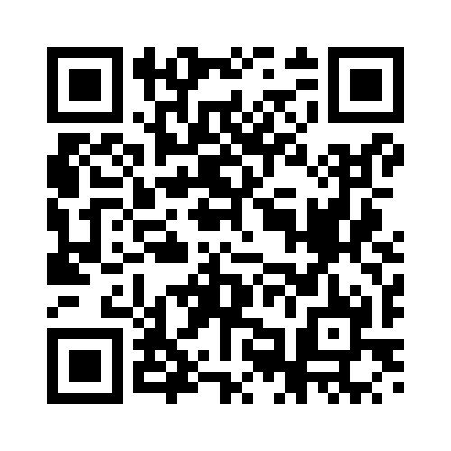

## Explore Posters by Theme

<a class="nav-card" href="posters-theme-1.qmd">
<h3>Theme 1 - Quantitative Methods, Analytics and Decision Science</h3>

Poster listings for theme 1.

</a>
<a class="nav-card" href="posters-theme-2.qmd">
<h3>Theme 2 - Genomics, Genetics and Bioinformatics</h3>

Poster listings for theme 2.

</a>
<a class="nav-card" href="posters-theme-3.qmd">
<h3>Theme 3 - Sensing, Imaging and Phenotyping</h3>

Poster listings for theme 3.

</a>
<a class="nav-card" href="posters-theme-4.qmd">
<h3>Theme 4 - Software Development and Research Enablement</h3>

Poster listings for theme 4.

</a> 

### Short Poster Presentations
PhD students will be invited to give a brief **3-5 minute “elevator pitch”** alongside their poster. This is an opportunity to introduce yourself, provide a concise overview of your project, highlight its significance, and encourage further discussion during the poster session.
Subject to available time, researchers who opt in may also be invited to give a short poster presentation.

### Poster Awards
There will be one prize in each of two categories:

- **Best Poster**
- **Best Poster Pitch**

Both are People’s Choice prizes, and everyone is invited to vote. Scan the QR code below to visit the GroupMap site and cast your votes.

<!-- banner section -->
::: {.card .text-center .p-4 .my-4 style="background-color: #f8f9fa; border-radius: 8px;"}

{width=250}

:::

<!-- banner section -->
<!-- ::: {.card .text-center .p-4 .my-4 style="background-color: #f8f9fa; border-radius: 8px;"}

### Poster Submission Portal
Are you presenting a poster at the symposium? Submit your poster details via the Google Form and upload your PDF poster to the relevant Box folder. 

**Deadline: 25 October 2026**
 

<!-- [Submit Your Poster ↗](https://forms.gle/Mvy8dTBK3WoeChHa6){.btn .btn-primary .btn-lg role="button" target="_blank"} -->
<!-- [Submit Your Poster ↗](https://forms.gle/Mvy8dTBK3WoeChHa6){.btn .btn-dark .btn-lg role="button" target="_blank"} -->

<!-- [Submit Your Poster Details ↗](https://forms.gle/Mvy8dTBK3WoeChHa6){.btn .btn-lg role="button" target="_blank" style="background-color: #00808b; color: white; border-color: #00808b"}

[Upload Your Poster ↗](https://adelaideuniversity.box.com/s/695xdh3wtmjykrd9vrs87xnzzxe5vw1l){.btn .btn-lg role="button" target="_blank" style="background-color: #00808b; color: white; border-color: #00808b"} -->

::: -->

## Poster Guidelines

We encourage all AAGI Symposium participants to prepare a poster showcasing their research, project, tools, or area of work. The poster session provides an opportunity to share ideas, highlight your work, and foster discussion and collaboration across the AAGI community.

### Poster Templates
The AAGI poster templates can be downloaded from this Box folder: 

[AAGI Poster Templates ↗](https://app.box.com/folder/419916371189){.btn .btn-lg role="button" target="_blank" style="background-color: #00808b; color: white; border-color: #00808b"}

### Poster Content
Posters should clearly communicate:

- The research, project, tool, or area of work being presented.
- The problem, question, or objective being addressed.
- The methods, approach, or workflow used.
- Key findings, outcomes, or expected impacts (where available).
- Contact details to enable follow-up discussions and collaboration.

### Poster Format
- **Size:** A0 (841 × 1189 mm)
- **Orientation:** Portrait

Posters will be displayed on double-sided poster boards, with two A0 portrait posters displayed on each side.

### QR Code
Please include a **QR code placeholder** on your poster. This will be used to link to the digital version of your poster on the symposium website.
A minimum size of **8 × 8 cm** is recommended to ensure the QR code can be scanned easily.

### File Requirements
- **Format:** PDF 

- **File name:** Please use the following format: [Poster_SurnameFirstName.pdf]{style="color: navy;"}
    - Example: [Poster_SmithJohn.pdf]{style="color: navy;"}

- **Number of posters:** One poster per participant. Collaborative group posters are encouraged where a project has multiple contributors. 

<!-- - Example: `2026AAGISymposium_poster_Smith_J.pdf` -->

<!-- - Example: [2026AAGISymposium_poster_Smith_J.pdf]{style="color: navy;"} --> 

### Poster Submission 

**Submission deadline: 25 October 2026**

This deadline allows sufficient time for posters to be printed in Perth and ensures they are ready for display at the symposium.

### Submission Process

Poster submission involves **two steps:**

**1. Complete the Google Form**

The Google form collects your poster details and a few questions about the poster showcase. A confirmation email will be sent to the email address you provide.

[Submit Your Poster Details ↗](https://forms.gle/Mvy8dTBK3WoeChHa6){.btn .btn-lg role="button" target="_blank" style="background-color: #00808b; color: white; border-color: #00808b"}

**2. Upload your poster to Box**

Use the Box link to upload your PDF poster. You do not need a Box account to upload a file.

[Upload Your Poster ↗](https://adelaideuniversity.box.com/s/695xdh3wtmjykrd9vrs87xnzzxe5vw1l){.btn .btn-lg role="button" target="_blank" style="background-color: #00808b; color: white; border-color: #00808b"}

<!-- 
Use the Box link corresponding to your selected poster theme to upload your PDF poster. You do not need a Box account to upload a file.

Please make sure you upload your poster to the folder corresponding to the theme selected in the Google Form.

[Poster - Theme 1 - Upload ↗](https://adelaideuniversity.box.com/s/tyucggov6fpm3tf0eq6c4dl5h57mzeqc){.btn .btn-lg role="button" target="_blank" style="background-color: #00808b; color: white; border-color: #00808b"}

[Poster Theme 2 - Upload ↗](https://adelaideuniversity.box.com/s/eoauyw1tgrujeva9xmke32uc75et2b9w){.btn .btn-lg role="button" target="_blank" style="background-color: #00808b; color: white; border-color: #00808b"}

[Poster Theme 3 - Upload ↗](https://adelaideuniversity.box.com/s/byv4l5antrfofs9q8lb59voe2hhosmjy){.btn .btn-lg role="button" target="_blank" style="background-color: #00808b; color: white; border-color: #00808b"}

[Poster Theme 4 - Upload ↗](https://adelaideuniversity.box.com/s/yc612gta9lt0t5evtnaluunuhd1dr22h){.btn .btn-lg role="button" target="_blank" style="background-color: #00808b; color: white; border-color: #00808b"}

 -->
