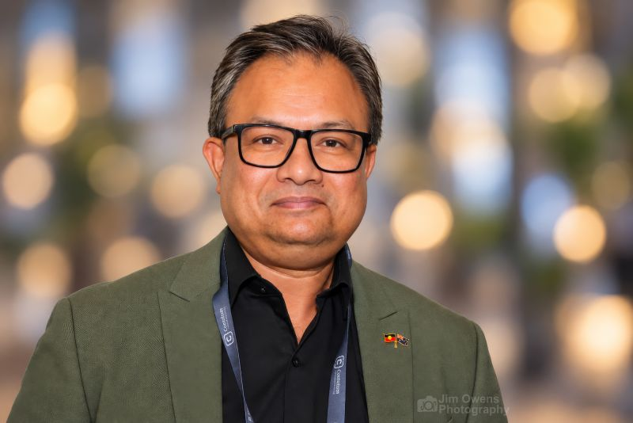

**Date:** Wednesday 11 November 2026  
**Time:** 16:00 - 17:30  
**Venue:** QT Perth, Murray Room

**Chair**: Mark Gibberd

## Summary

The Higher Degree by Research (HDR) session brings together HDR students and early career researchers from across AAGI for a panel and interactive Q&amp;A. The session will provide an opportunity to connect with peers, experienced researchers and industry representatives, exchange experiences and gain insights into navigating research careers. Discussion will explore career development, industry engagement, mentoring and the transition from academic research to industry and other career pathways. The panel will also encourage participants to reflect on the skills, networks and opportunities that can support their professional growth, while fostering connections across the AAGI community and strengthening links between emerging researchers and the broader grains research sector.

## Panel Members

<article class="speaker-card">

<h3>Scott Chapman</h3>

The University of Queensland (UQ), Australia

</article>

<article class="speaker-card">

<h3>Fred van Eeuwijk</h3>

Wageningen University & Research (WUR), Netherlands

</article>

<article class="speaker-card">

<h3>Peter Bird</h3>

Grains Research and Development Corporation (GRDC-West), Australia

</article>

<article class="speaker-card">

<h3>Julia Easton</h3>

Curtin University (CU), Australia

</article>

<!-- 

<article class="speaker-card">

<h3>Hasnein Tareque</h3>

Department of Primary Industries and Regional Development (DPIRD), Australia

</article>

 -->

<!-- 

<article class="speaker-card">

<h3>Kate Trinajstic</h3>

Curtin University (CU), Australia

</article>

 -->

Others to be confirmed.
