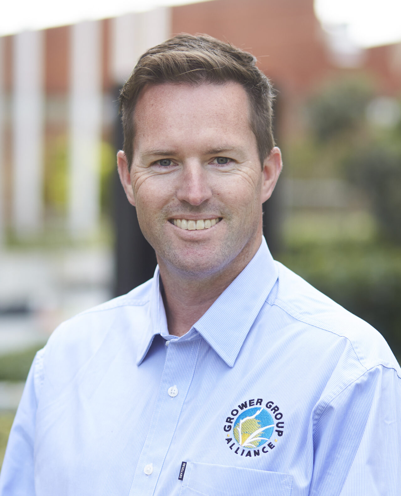
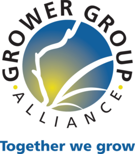
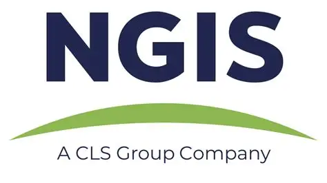
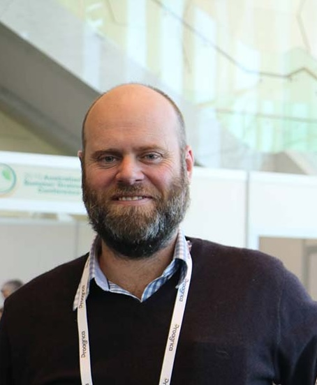

**Date:** Tuesday 10 November 2026  
**Time:** 14:00 - 15:30  
**Venue:** QT Perth, Murray Room

**Chair:** Mark Gibberd

## Summary

Chaired by Mark Gibberd, the Industry, Government and Growers (IGG) session brings together perspectives from across the Australian grains sector to explore how research, data and analytics can address industry needs and support innovation. The session is being planned as a panel discussion, with representatives from industry, government and grower groups sharing current priorities, practical challenges and opportunities for collaboration with AAGI. It will provide an opportunity to exchange ideas and discuss how AAGI can continue to deliver value for the Australian grains industry.

<!-- The Industry, Government and Growers (IGG) session brings together perspectives from across the Australian grains sector to explore how research, data and analytics can address industry needs and support innovation. Featuring presentations from representatives across industry, government and grower groups, the session will highlight current priorities, practical challenges and opportunities for collaboration with AAGI. The presentations will be followed by a panel discussion and Q&amp;A, providing an opportunity to exchange ideas, share insights and discuss how AAGI can continue to deliver value for the Australian grains industry. -->
 

## Speakers

<article class="speaker-card">

<h3>Peter Bird</h3>

Grains Research and Development Corporation (GRDC-West)

</article>

<article class="speaker-card">

<h3>Dion Bennett</h3>

Australian Grain Technologies (AGT)

</article>

<article class="speaker-card">

<h3>Daniel Kidd</h3>

Grower Group Alliance (GGA)

</article>

<article class="speaker-card">

<h3>Moreno Mattaboni</h3>

 NGIS Australia

</article>

 

<article class="speaker-card">

<h3>Joe Eyre</h3>

The University of Queensland (UQ)

</article>

