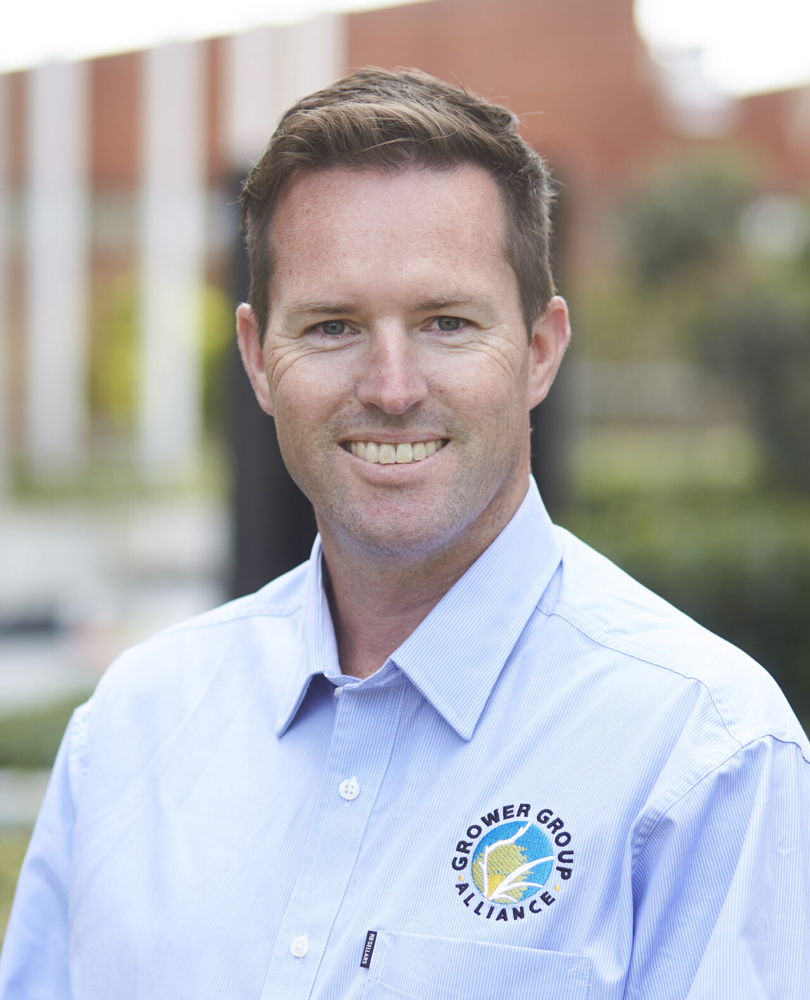

**Date:** Tuesday 10 November 2026  
**Time:** 14:00 - 15:30  
**Venue:** QT Perth, Murray Room

**Chair**: Sudhir Yadav 
<!-- and Joe Eyre -->

## Summary

The Industry, Government and Growers (IGG) session brings together perspectives from across the Australian grains sector to explore how research, data and analytics can address industry needs and support innovation. Featuring presentations from representatives across industry, government and grower groups, the session will highlight current priorities, practical challenges and opportunities for collaboration with AAGI. The presentations will be followed by a panel discussion and Q&amp;A, providing an opportunity to exchange ideas, share insights and discuss how AAGI can continue to deliver value for the Australian grains industry.
 

## Speakers

<article class="speaker-card">

<h3>Peter Bird</h3>

Grains Research and Development Corporation (GRDC-West), Australia

</article>

<article class="speaker-card">

<h3>Dion Bennett</h3>

Australian Grain Technologies (AGT), Australia

</article>

<article class="speaker-card">

<h3>Daniel Kidd</h3>

Grower Group Alliance (GGA), Australia

</article>

 -->

Others to be confirmed.

<!-- 

<article class="speaker-card">

<h3>Geoff Thomas</h3>

Department of Primary Industries and Regional Development (DPIRD)

</article>

