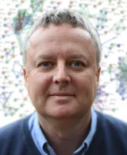

**Date:** Wednesday 11 November 2026  
**Time:** 14:00 - 15:30  
**Venue:** QT Perth, Murray Room

**Chair**: Julian Taylor

## Summary

The AAGI Partners session highlights the contributions, expertise and perspectives of AAGI’s partner organisations, showcasing the diverse research and activities supporting innovation across the Australian grains industry. Speakers will share insights into their current work, strategic priorities and emerging opportunities, highlighting how collaboration across the AAGI network can strengthen research, data analytics and knowledge exchange. The session will also provide an opportunity to explore synergies between partner organisations, foster connections and identify opportunities for future collaboration to address shared challenges and maximise the impact of AAGI.

## Speakers

<article class="speaker-card">

<h3>Fred van Eeuwijk</h3>

Wageningen University & Research (WUR), Netherlands

</article>

<article class="speaker-card">

<h3>Dave Edwards</h3>

University of Western Australia (UWA), Australia

</article>

<article class="speaker-card">

<h3>Emi Tanaka</h3>

Australian National University (ANU), Australia

</article>

<article class="speaker-card">

<h3>Valeria Paccapelo</h3>

Queensland Department of Primary Industries (QDPI), Australia

</article>

