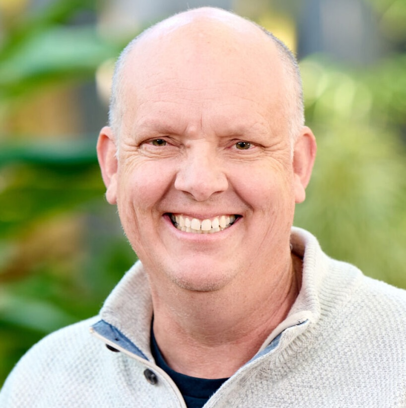
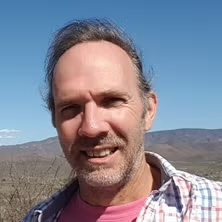
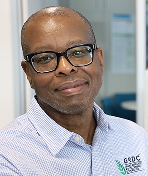

**Date:** Thursday, 12 November 2026  
**Time:** 11:00 - 13:00  
**Venue:** QT Perth, Murray Room

**Chair:** Nathan O'Callaghan

## Summary

Join us for a closing panel discussion with AAGI's strategic partner leads and a representative from the Grains Research and Development Corporation (GRDC). Chaired by Nathan O'Callaghan, the panel will reflect on what AAGI has achieved, the opportunities and challenges ahead, and how the partnership can continue to deliver value for the Australian grains industry.

This is your opportunity to put questions directly to the panel. You can submit your questions throughout the Symposium using the GroupMap link via the QR code. 
<!-- **Please note that the link will close at 16:00 on Wednesday 11 November**. -->

We are particularly interested in questions that look ahead, such as where AAGI should focus next, how analytics can deliver greater value to growers and the Australian grains industry, what capabilities and ways of working we will need, and how AAGI can continue to be a strong avenue to study and build a career. The most useful questions will be relevant to the whole room and draw on the panel’s collective perspective, rather than focusing on an individual project or personal circumstance.

Submitted questions will be reviewed before the session, and similar questions may be combined. We may not be able to put every question to the panel, but all contributions will help shape the discussion.

The session will be followed by an awards ceremony, celebrating the best poster and the best 3-minute pitch from the poster session.

Scan the GroupMap QR code to submit questions that will be answered during this session. The link also lets you vote for the best 3-minute pitch and the best poster.

[Submit Questions on GroupMap ↗](https://curtin-join.groupmap.com/A91-566-F5B){.btn .btn-lg role="button" target="_blank" style="background-color: #00808b; color: white; border-color: #00808b"}

::: {.card .text-center .p-4 .my-4 style="background-color: #f8f9fa; border-radius: 8px;"}

{width=250}

:::

## Panel members

<article class="speaker-card">

<h3>Mark Gibberd</h3>

Curtin University (CU), Australia

</article>

<article class="speaker-card">

<h3>Scott Chapman</h3>

The University of Queensland (UQ), Australia

</article>

<article class="speaker-card">

<h3>Julian Taylor</h3>

Adelaide University (AU), Australia

</article>

<article class="speaker-card">

<h3>Washington Gapare</h3>

Grain Research and Development Corporation (GRDC), Australia

</article>

