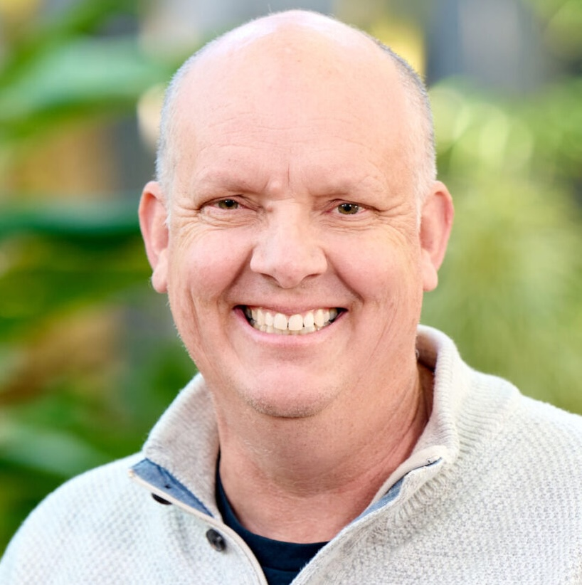
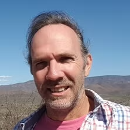
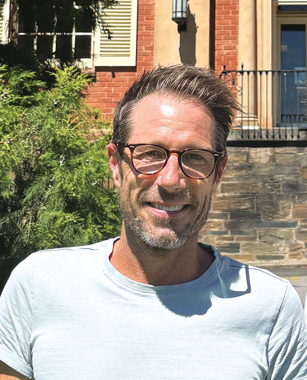
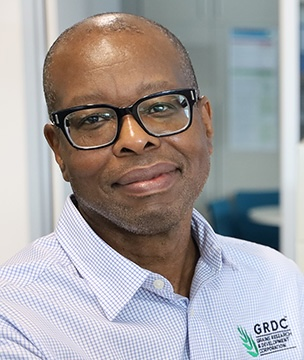

**Date:** Thursday, 12 November 2026  
**Time:** 11:00 - 13:00  
**Venue:** QT Perth, Murray Room

**Chair**: Nathan O'Callaghan

## Summary

Join us for a closing panel discussion with AAGI's strategic partner leads and a representative from the Grains Research and Development Corporation (GRDC). Chaired by Nathan O'Callaghan, the panel will reflect on what AAGI has achieved, the opportunities and challenges ahead, and how the partnership can continue to deliver value for the Australian grains industry.

This is your chance to put questions directly to the panel. During the Symposium, you can submit questions through the GroupMap QR code link.

The session will be followed by an awards ceremony, celebrating the best poster and the best 3-minute pitch from the poster session.

## Panel members

<article class="speaker-card">

<h3>Mark Gibberd</h3>

Curtin University (CU), Australia

</article>

<article class="speaker-card">

<h3>Scott Chapman</h3>

The University of Queensland (UQ), Australia

</article>

<article class="speaker-card">

<h3>Julian Taylor</h3>

Adelaide University (AU), Australia

</article>

<article class="speaker-card">

<h3>Washington Gapare</h3>

Grain Research and Development Corporation (GRDC), Australia

</article>

