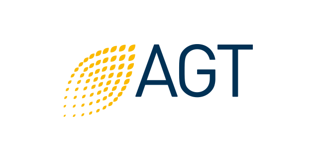
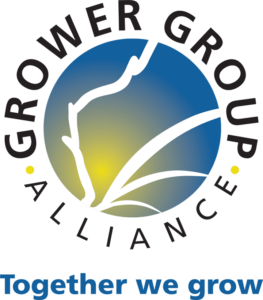
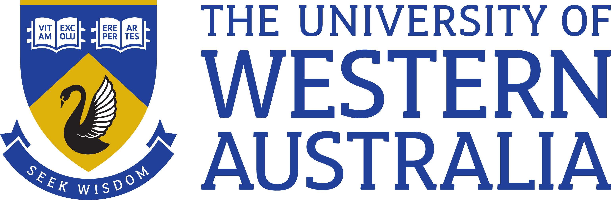
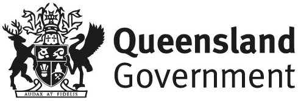

Explore the symposium talks and panel sessions below.

<a class="nav-card" href="talks-panels-nodes-CU.qmd">
<h3>Curtin University</h3>

Hear research talks from the Curtin University AAGI node.

</a>
<a class="nav-card" href="talks-panels-nodes-UQ.qmd">
<h3>The University of Queensland</h3>

Hear research talks from the University of Queensland AAGI node.

</a>
<a class="nav-card" href="talks-panels-nodes-AU.qmd">
<h3>Adelaide University</h3>

Hear research talks from the Adelaide University AAGI node.

</a>
<a class="nav-card" href="talks-panels-igg.qmd">
<!--  -->
<h3>Industry, Government and Growers (IGG)</h3>

Explore perspectives from industry, government and growers, followed by a panel Q&amp;A.

</a>
<a class="nav-card" href="talks-panels-partners.qmd">
<h3>AAGI Partners</h3>

Learn about the work and perspectives of AAGI's partner organisations.

</a>
<a class="nav-card" href="talks-panels-hdr-networking.qmd">
<!--  -->
<h3>HDR Networking</h3>

Connect with fellow higher degree by research students during this networking and Q&amp;A session.

</a>
<a class="nav-card" href="talks-panels-sp-leads.qmd">
<!--  -->
<h3>Strategic Partner Leads & GRDC Q&A</h3>

Put your questions to AAGI's strategic partner leads and a GRDC representative in an Q&A, followed by an awards ceremony.

</a>
