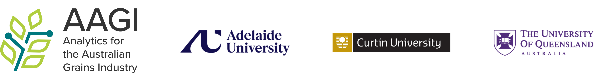
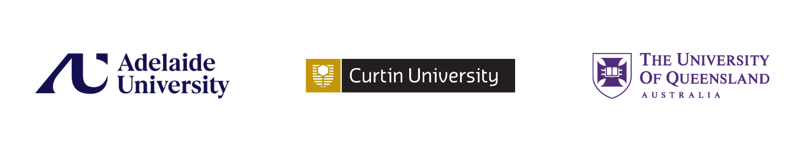

Explore the symposium talks and panel sessions below.

<a class="nav-card" href="talks-panels-nodes.qmd">
<!--  -->
<!--  -->

<h3>AAGI Nodes</h3>

Hear research talks from Curtin University, University of Queensland and Adelaide University AAGI nodes.

</a>
<a class="nav-card" href="talks-panels-igg.qmd">
<!--  -->
<h3>Industry, Government and Growers (IGG)</h3>

Explore perspectives from industry, government and growers, followed by a panel Q&amp;A.

</a>
<a class="nav-card" href="talks-panels-partners.qmd">
<!-- 

 -->
<h3>AAGI Partners</h3>

Learn about the work and perspectives of AAGI's partner organisations.

</a>
<a class="nav-card" href="talks-panels-hdr-networking.qmd">
<!--  -->
<h3>HDR Networking</h3>

Connect with fellow higher degree by research students during this networking and Q&amp;A session.

</a>
<a class="nav-card" href="talks-panels-sp-leads.qmd">

<h3>SP Leads and Awards</h3>
<h3>AAGI 2.0: Preparing for the Future</h3>

This workshop will explore AAGI 2.0 and preparations for the future.

</a>
