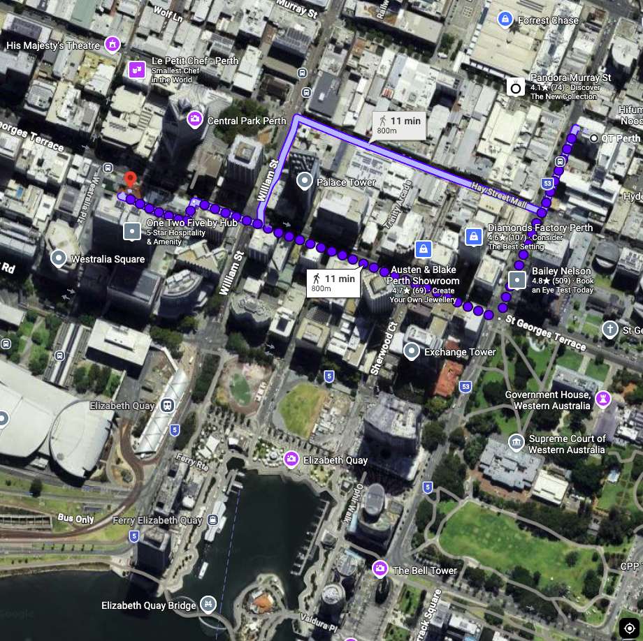

**Date:** Wednesday, 11 November 2026  
**Time:** 11:00 - 13:00  
**Venue:** Curtin, 137 St Georges Terrace, Room: Gallery

**📍 Please note this is an off-site session **

The venue is approximately 800 m, or a 10-minute walk, from the QT Hotel Perth.

## Summary

This workshop will showcase how modern computational approaches are shaping genomic and omics research. It will begin with a focus on Trusted Research Environments (TREs) and federated analytics and learning in omics, highlighting how secure and controlled research environments can support the analysis and sharing of sensitive or distributed data while enabling collaboration across institutions. The workshop will also highlight reproducible workflows, computational approaches and tools being developed and applied across different areas of bioinformatics, providing an opportunity to share expertise, build connections and explore future opportunities for collaboration across AAGI.

## Agenda

<table class="table">
<thead>
<tr><th scope="col">TIME</th><th scope="col">SESSION</th></tr>
</thead>
<tbody>
<tr><td><strong>11:00 - 11:10</strong></td><td><strong>Opening and workshop overview</strong> <em>Dr Irina Kuznetsova</em></td></tr>
<tr><td><strong>11:10 - 11:40</strong></td><td><strong>Invited presentation</strong> <strong>Trusted Research Environments (TREs) and federated analytics/learning in omics</strong> <em>Prof Nicola Armstrong</em></td></tr>
</tbody>
<tbody>
<tr><td colspan="2"><strong>11:40 - 12:40 &nbsp; Research case studies: Reproducible workflows in practice</strong> <em>Bioinformatics workflow and automation across AAGI</em></td></tr>
<tr><td><strong>11:40 - 11:50</strong></td><td><strong>Single-cell analysis and workflow package development</strong> <em>Dr Irina Kuznetsova</em></td></tr>
<tr><td><strong>11:50 - 12:00</strong></td><td><strong>Computational genotype imputation for genomic selection/breeding</strong> <em>Dr Huan Zhao</em></td></tr>
<tr><td><strong>12:00 - 12:10</strong></td><td><strong>Haplotype phasing: computational approaches and applications</strong> <em>Dr Mario Fruzangohar</em></td></tr>
<tr><td><strong>12:10 - 12:20</strong></td><td><strong>Computational genetic analysis with wgaim</strong> <em>Dr Beata Sznajder</em></td></tr>
<tr><td><strong>12:20 - 12:30</strong></td><td><strong>From eQTL to network construction</strong> <em>Dr Dinesha Jayawardana</em></td></tr>
<tr><td><strong>12:30 - 12:40</strong></td><td><strong>Automation, reproducibility, portability: OpenWDL and Sprocket</strong> <em>Mr George Malone</em></td></tr>
<tr><td><strong>12:40 - 13:00</strong></td><td><strong>Community discussion and closing remarks</strong> <strong>Advancing bioinformatics across AAGI</strong> <em>Dr Irina Kuznetsova + all contributors</em></td></tr>
</tbody>
</table>

**Timing note:** *The workshop is scheduled to start at 11:00 am, with a 20-minute collaborative discussion concluding the main program to explore forward-looking directions for bioinformatics across AAGI.*

## Resources

- Slides: Coming soon
