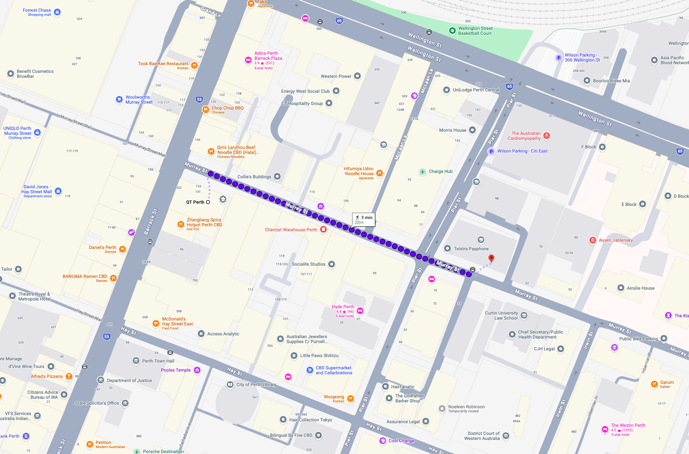

**Date:** Monday, 9 November 2026  
**Time:** 14:00 - 18:00  
**Venue:** Room 212, Curtin Business School, 78 Murray Street

**Chair:** Dave Edwards

**📍 Please note this is an off-site session **

The venue is approximately 160 m, or a 3-minute walk, from the QT Hotel Perth.

## Summary 

Advances in bioinformatics, genomics and machine learning are transforming how we investigate crop genetic diversity, understand plant-pathogen interactions and improve agricultural traits. This workshop will showcase emerging computational approaches and their practical applications in crop research, bringing together researchers from across AAGI and collaborating institutions. Presentations will explore recent developments in graph pangenomics, gene presence–absence variation, structural variation analysis and genomic visualisation, alongside machine learning approaches for variant discovery, trait prediction, genomic selection and crop image analysis. The programme will also highlight advances in multi-omics integration, AI-driven protein–protein interaction prediction, and large language models for scientific literature mining and knowledge curation. Through a combination of methodological developments and applied research case studies, the workshop aims to demonstrate how computational technologies are helping researchers extract biological insights from increasingly complex datasets, address challenges in crop improvement and disease resistance, and encourage knowledge exchange and collaboration across the grains research community. The event is open to all AAGI members and associates, particularly those involved in managing, analysing or interpreting crop research data, regardless of their bioinformatics background.

<!-- Advances in bioinformatics, genomics and machine learning are transforming how we investigate crop genetic diversity, understand plant-pathogen interactions and improve agricultural traits. This workshop will showcase emerging computational approaches and their practical applications in crop research, bringing together researchers from across AAGI, GRDC and collaborating institutions. Presentations will explore recent developments in graph pangenomics, gene presence–absence variation, structural variation analysis and genomic visualisation, alongside machine learning approaches for variant discovery, trait prediction, genomic selection and crop image analysis. The programme will also highlight advances in multi-omics integration, AI-driven protein–protein interaction prediction, and large language models for scientific literature mining and knowledge curation. Through a combination of methodological developments and applied research case studies, the workshop aims to demonstrate how computational technologies are helping researchers extract biological insights from increasingly complex datasets, address challenges in crop improvement and disease resistance, and encourage knowledge exchange and collaboration across the grains research community. The event is open to all AAGI/GRDC members and associates, particularly those involved in managing, analysing or interpreting crop research data, regardless of their bioinformatics background. -->

## Agenda

<table class="table">
<thead>
<tr><th scope="col">TIME</th><th scope="col">SESSION</th></tr>
</thead>
<tbody>
<tr><td style="white-space: nowrap"><strong>14:00 - 14:05</strong></td><td><strong>Welcome and Introduction</strong> <em>Dave Edwards (UWA)</em></td></tr>
<tr><td style="white-space: nowrap"><strong>14:05 - 14:20</strong></td><td><strong>Comparing gene presence/absence variation between Orthofinder and pangenome graphs</strong> <em>Mitchell Bestry (UWA)</em></td></tr>
<tr><td style="white-space: nowrap"><strong>14:20 - 14:35</strong></td><td><strong>Capturing the missing gene content of elite wheat by analysis of wheat landraces</strong> <em>Teng Li (UWA)</em></td></tr>
<tr><td style="white-space: nowrap"><strong>14:35 - 14:50</strong></td><td><strong>Interactive visualization of synteny and structural variation</strong> <em>Wasin Pipattungsakul (AU)</em></td></tr>
<tr><td style="white-space: nowrap"><strong>14:50 - 15:05</strong></td><td><strong>Leveraging pangenomic features for trait prediction in soybean</strong> <em>Shriprabha Upadhyaya (UWA)</em></td></tr>
<tr><td style="white-space: nowrap"><strong>15:05 - 15:20</strong></td><td><strong>Applying Bioinformatics to Crop Improvement: Mining Natural Variation at the TRY Locus for Insect-Resistant Canola</strong> <em>Thomas Bergmann (UWA)</em></td></tr>
<tr><td style="white-space: nowrap"><strong>15:20 - 15:35</strong></td><td><strong>Integrating SNPs, functional InDel features, and machine learning to identify genetic variants associated with common bacterial blight resistance in common bean</strong> <em>Shameela Mohamedikbal (UWA)</em></td></tr>
<tr><td style="white-space: nowrap"><strong>15:35 - 15:50</strong></td><td><strong>Characterising structural variation in the Brassica host and blackleg pathogen genomes</strong> <em>Felipe Albornoz (UWA)</em></td></tr>
</tbody>
<tbody>
<tr><td colspan="2"><strong>15:50 - 16:20 &nbsp; Break</strong></td></tr>
<tr><td style="white-space: nowrap"><strong>16:20 - 16:35</strong></td><td><strong>From isoforms to Starships: multi-omic insights into barley and Pyrenophora teres f. teres interactions</strong> <em>Yutathkarn (Daniel) Coles and Fatima Naim (CU)</em></td></tr>
<tr><td style="white-space: nowrap"><strong>16:35 - 16:50</strong></td><td><strong>Benchmarking structural predictors and pLM binary classifiers for predicting cross-kingdom protein-protein interactions in crop disease pathosystems</strong> <em>Pavel Misiun and Kristina Gagalova (CU)</em></td></tr>
<tr><td style="white-space: nowrap"><strong>16:50 - 17:05</strong></td><td><strong>Automated literature mining and LLM-based database curation for crop science</strong> <em>Jack Bruton (UWA)</em></td></tr>
<tr><td style="white-space: nowrap"><strong>17:05 - 17:20</strong></td><td><strong>How can haplotypes and machine learning improve genomic selection in Brassica napus</strong> <em>Tessa MacNish (UWA)</em></td></tr>
<tr><td style="white-space: nowrap"><strong>17:20 - 17:35</strong></td><td><strong>Multimodal machine learning and explainable AI uncovers genomic regions associated with wheat yield prediction</strong> <em>Rohini Trivedi (UWA)</em></td></tr>
<tr><td style="white-space: nowrap"><strong>17:35 - 17:45</strong></td><td><strong>A comparative analysis on training population optimization for genomic prediction in wheat</strong> <em>Ze Wu (UWA)</em></td></tr>
<tr><td style="white-space: nowrap"><strong>17:45 - 17:55</strong></td><td><strong>Bioinformatics and machine learning approaches to investigate the genetic basis of drought stress response in legumes</strong> <em>Nimesha Kankanamge (UWA)</em></td></tr>
<tr><td style="white-space: nowrap"><strong>17:55 - 18:00</strong></td><td><strong>Thanks and wrap up</strong> <em>Dave Edwards (UWA)</em></td></tr>
</tbody>
</table>

<!-- 
## Resources

- Slides: Coming soon -->
