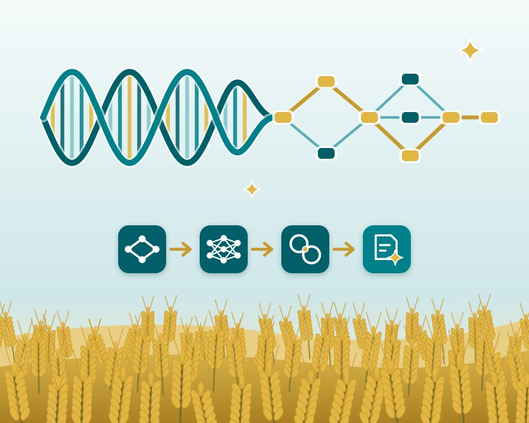

Explore the symposium workshops below.

<!-- Choose number of nav cards per row (3 or 2) based on the number of workshops you have. If you have 4 workshops, use 2 per row. If you have 6 workshops, use 3 per row. -->

<a class="nav-card" href="workshop-1.qmd">
<h3>Workshop 1</h3>
<h3>AI in AAGI: From Tools to Workflows</h3>

This workshop will explore the application of AI in AAGI, focusing on the transition from individual tools to integrated workflows.

</a>
<a class="nav-card" href="workshop-2.qmd">
<h3>Workshop 2</h3>
<h3>Efficient Trial Design with *speed*</h3>

This workshop will explore efficient trial design with *speed*.

</a>
<a class="nav-card" href="workshop-3.qmd">
<h3>Workshop 3</h3>
<h3>Bioinformatics across AAGI: Research, Tools and Challenges</h3>

This workshop will explore bioinformatics across AAGI, including research, tools and challenges.

</a>
<a class="nav-card" href="workshop-wur.qmd">
<h3>WUR Workshop</h3>
<h3>LMMs, AI &amp; ODEs for G×E</h3>

This workshop covers mixed model splines, random regression, kernels and AI for genotype-by-environment interactions, and ODE-based crop modelling.

</a>
<a class="nav-card" href="workshop-bioinfo-satellite.qmd">
<h3>Bioinformatics Satellite Meeting</h3>
<h3>Applied Bioinformatics: Emerging Tools and Data-Driven Approaches in Crop Research</h3>

This workshop will explore emerging tools and data-driven approaches in crop research.

</a> 

